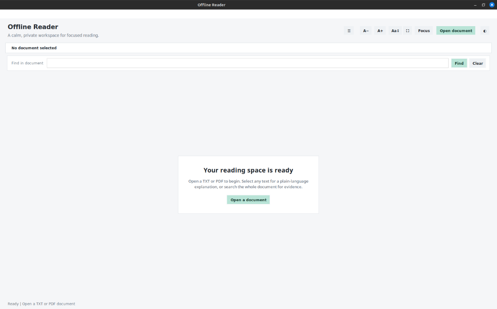
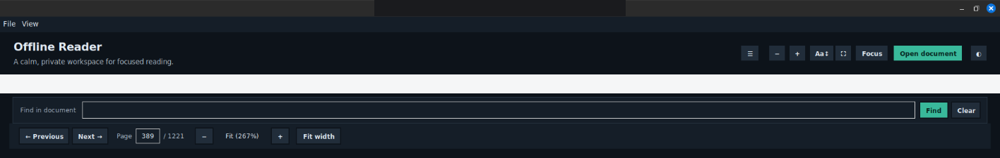

# Offline AI Reader

A lightweight desktop app for reading text and PDF documents while getting instant, context-aware explanations for selected words or phrases. The app combines a Tkinter-based reader interface with a local Flask API and a locally hosted LLM backend so it can work without relying on external cloud services.

This project is designed for personal study, assisted reading, and quick semantic lookup in local documents.

## License

Offline Reader is licensed under the [GNU Affero General Public License v3.0
only](LICENSE). PyMuPDF, llama.cpp, and any GGUF model have their own licence
terms; model weights and llama.cpp are not included in this repository or the
desktop package.

## Highlights

- Open reflowable `.txt` files and visually faithful `.pdf` pages
- Navigate PDF pages with page controls, zoom, and fit-to-width
- Select a word, phrase, or sentence and see a contextual definition popup
- Save selected passages and optional AI explanations into editable local notes
- Organize notes with collections and tags, search note content, and jump back to verified source locations
- Ask follow-up questions about the selected text from the same popup
- Search the full open document locally and jump directly to matching passages
- Give follow-up questions a small set of ranked document excerpts instead of sending the whole book to the model
- Show source references (for example, `[R1]`) with clickable links to the cited passage or PDF page
- Run the AI layer entirely on a local model through `llama.cpp`
- Keep the experience offline-friendly by avoiding external API calls for the main workflow

## Screenshots

The workspace screen below shows the reader before a document is opened. The
second image shows the PDF navigation and search controls; the document page
itself is intentionally omitted.





## Project goals

The project aims to make reading easier by giving users an instant understanding of unfamiliar terms in context instead of forcing them to switch to a separate dictionary or search engine. The system tries to keep the workflow simple:

1. Open a document
2. Select text
3. View a concise explanation generated from context
4. Ask a follow-up question if needed

## Architecture overview

The project is split into a few logical components:

- `app/` contains the desktop reader UI and controller
- `documents/` owns document loading, rendering, reading-context extraction, and local passage retrieval
- `ai/` owns the reader-facing AI request boundary
- `services/` contains the local API client and Flask backends
- `notes/` contains the local notes, highlights, quiz, and flashcard persistence layer
- `scripts/` contains setup, launch, packaging, and release-check utilities
- `tests/` contains automated tests
- `docs/history/` contains historical patch notes
- `archive/prototypes/` retains superseded code outside the active runtime and release archive
- `models/` contains locally installed GGUF models (not included in source releases)
- `llama.cpp/` is the bundled local inference engine used for model serving
- `sample.txt` provides a quick sample document for testing

### Main application flow

The application flow is roughly:

- `app/main.py` launches the GUI
- `app/ui.py` turns user interaction into controller calls and renders the result
- `app/reader_controller.py` coordinates documents, context, and AI requests
- `documents/` opens TXT/PDF files, renders PDF pages, builds `ReadingContext`, and indexes bounded passages with character offsets or page locations
- `documents/retrieval.py` ranks matching passages using local lexical scoring, section headings, and optional local embeddings; scanned-page OCR is available when Tesseract is installed
- `ai/assistant.py` turns a `ReadingContext` into explanations and follow-up answers
- `app/popup.py` displays the explanation popup and delegates questions to the UI
- `services/api_client.py` sends requests to the local Flask service
- `services/llm_service.py` builds a context-aware prompt and calls a local LLM-compatible endpoint

## Repository structure

```text
os_root/
├── app/
│   ├── main.py
│   ├── popup.py
│   ├── reader_controller.py
│   ├── ui.py
├── ai/
│   ├── assistant.py
│   └── study_tools.py
├── documents/
│   ├── embeddings.py
│   ├── manager.py
│   ├── models.py
│   └── retrieval.py
├── notes/
│   └── store.py
├── scripts/
│   ├── launch_reader.sh
│   ├── package_source_release.py
│   └── ...
├── docs/
│   └── history/
├── archive/
│   └── prototypes/       # Reference only; excluded from source releases
├── services/
│   ├── api_client.py
│   └── llm_service.py
├── tests/
│   └── ...
├── llama.cpp/
├── models/
│   └── ...               # Local model files; excluded from source releases
├── README.md
├── DEPLOYMENT.md
├── INSTALL_LINUX_MINT.md
├── app_config.py
├── requirements.txt
├── run_reader.py
├── sample.txt
└── ...
```

## Key files

### `app/main.py`
Starts the Tkinter reader interface.

### `app/ui.py`
Contains Tkinter widgets, page navigation, and selection interaction. It does not parse documents or call the HTTP client directly.

### `app/reader_controller.py`
Coordinates the active document, creates `ReadingContext`, and requests explanations or follow-up answers.

### `documents/`
Provides testable TXT/PDF document models. PDF rendering and rectangle-to-text mapping live here rather than in the UI.

### `ai/assistant.py`
Provides the application's AI boundary. It receives `ReadingContext` rather than loose text strings.

### `app/popup.py`
Builds the floating explanation dialog and the expanded “Ask more...” interaction.

### `services/api_client.py`
Client-side HTTP layer used by the GUI to call the local Flask service.

### `services/llm_service.py`
Uses Flask to expose text explanations and Q&A endpoints. It sends prompts to a local OpenAI-compatible completion endpoint at `http://127.0.0.1:8080/v1/completions`.

### `services/llm_service_2.py`
Alternative implementation that invokes `llama-cli` directly instead of an HTTP endpoint.

### `models/tinyllama.gguf`
Prebundled model used for local inference.


## Document-wide search and AI references

Use **Find in document** or press `Ctrl+F` to search the active TXT/PDF. Results are ranked locally and show a stable location. Double-click a result to jump to its character range in a TXT document or to its page in a PDF.

When asking a follow-up question, the reader searches the full document and sends only a small, bounded set of relevant excerpts to the local model. Each excerpt is labeled `[R1]`, `[R2]`, and so on. The model is instructed to use these labels for evidence-based citations; the popup also displays clickable source links for the retrieved passages.

Search works offline with lexical ranking by default, including conservative word normalization and a small synonym map. It detects clear TXT headings and larger-font PDF headings and uses section names as ranking signals. Optional semantic ranking uses a separate local llama.cpp embedding model and blends cosine similarity with lexical scores. The embedding server binds to loopback by default; if you override its host, queries and passage text are sent to that configured endpoint. Embeddings are enabled by setting `OFFLINE_READER_EMBEDDING_MODEL` to an embedding-capable GGUF file. `run_reader.py` then starts a separate embeddings server so the existing TinyLlama completion service is unchanged. Set `OFFLINE_READER_EMBEDDING_POOLING` when the model requires a pooling mode other than `mean`; the embeddings server uses port `8081` by default, configurable with `OFFLINE_READER_EMBEDDING_HOST` and `OFFLINE_READER_EMBEDDING_PORT`. Without an embedding model, or if the local embeddings service fails, search explicitly logs the problem and continues with lexical ranking. The embedding model is not bundled and must already be available locally; the configured pooling mode and model must be compatible with the installed llama.cpp build.

When a PDF page has little extractable text, the reader can OCR it locally using PyMuPDF and the system Tesseract executable. OCR is enabled by default for indexing and source highlighting; set `OFFLINE_READER_OCR_ENABLED=false` to disable it, or use `OFFLINE_READER_OCR_LANGUAGE` and `OFFLINE_READER_OCR_DPI` to configure the Tesseract language and render resolution. Install Tesseract and the desired language data separately; the application does not download them. Search citations and highlights retain PDF page locations. TXT and PDF highlights use source offsets or tolerant normalized word matching to handle line wrapping and punctuation differences.

Overlap filtering reduces duplicate excerpts. Inline `[R1]` citations are clickable only when that reference was actually returned by retrieval.

### Notes

Use **Save note** in a selection popup to create an editable note containing the selected passage and, when available, its AI explanation. Open **File → My notes**, use the sidebar's **My notes** action, or press `Ctrl+Shift+N` to browse and search notes. Notes support a title, plain-text/Markdown-style body, optional collection, comma-separated tags, and a source link. Save edits explicitly; unsaved edits are protected by a confirmation when switching notes or closing the notes window.

The notes, highlights, bookmarks, quizzes, and flashcard decks database is stored locally at `$XDG_DATA_HOME/offline-reader/notes.sqlite3` when `XDG_DATA_HOME` is set, otherwise at `~/.local/share/offline-reader/notes.sqlite3`. On POSIX systems the app restricts its data directory to owner access and the database file to owner read/write. Notes contain user-authored text and may include locally generated AI text; saved study tools contain cards or questions, answers, explanations, source passages, and review or attempt progress.

Source links retain the document path, SHA-256 fingerprint, selected quotation, and the strongest available locator (character offsets for TXT; page and selection rectangle for PDF). **Open source** checks that the original file exists and still matches its fingerprint before navigating. If it is missing or changed, the app does not jump to a possibly unrelated passage. Current notes do not yet offer automatic moved-file recovery, rich-text blocks, attachments, or automatic saving.

### Highlights and bookmarks

Select a passage in a TXT or text-based PDF and choose **Highlight** or **Bookmark** in the contextual popup. Highlights are restored for the matching document version (character ranges in TXT; page and selection rectangle in PDF). Open **File → Highlights & bookmarks**, use the sidebar action, or press `Ctrl+Shift+B` to browse, jump to, or delete saved items. The app verifies the source fingerprint before opening a saved location; changed or missing files are not navigated. Scanned PDFs without selectable text are not supported.

### Revision notes

Choose **Revision notes** in a selection popup to ask the local assistant for 3–6 concise bullets based only on the selected passage and its immediate context. The draft identifies that limited scope; it is not presented as a section or chapter summary. Review and edit the title and bullets, then choose **Save as note** to store them with a source link. If the local assistant is unavailable, the window shows the service error and does not enable saving generated notes.

### Passage quizzes

Choose **Quiz** in a selection popup to generate a passage-scoped quiz using the selected text and bounded immediate context through the local AI service. Choose 3, 5, or 8 questions, easy/medium/hard difficulty, and multiple-choice, true/false, or short-answer style. It is not a chapter- or document-wide quiz. Returned JSON is validated before saving; malformed or incomplete output is reported rather than shown as a valid quiz. Answers and explanations stay hidden until each answer is submitted. Objective answers use a simple case-insensitive exact match; short answers are recorded for self-review and are not automatically graded. Open **File → My quizzes…** to resume or delete saved quizzes. Submitted answers are saved locally, and **Open source** checks the original document fingerprint before navigating.

### Passage flashcards

Choose **Flashcards** in a selection popup to create 3, 5, or 8 question-and-answer cards from the selected passage and bounded immediate context using the local AI service. The cards are passage-scoped, not a chapter or document summary; the returned structure is validated before the deck is saved. The answer and explanation remain hidden until **Show answer**. After reveal, rate recall as **Again**, **Hard**, **Good**, or **Easy**. Cards start due immediately; the local scheduler uses a simple SM-2-inspired interval rule (Again: 10 minutes, Good: 1 day then 6 days and ease-based growth, Easy: 4 days initially, Hard: at least 1 day with slower growth). Review dates and progress persist locally. Choose **File → Review due flashcards** or **Review due cards** in the sidebar for a cross-deck session; rated cards leave the current session until they are due again. Open **File → My flashcards…** or use the sidebar's **My flashcards** action to resume or delete decks; the list shows each deck's due count. **Open source** verifies that the original document has not changed before navigating. This is a lightweight scheduler, not FSRS, an automatic grading system, or a guarantee of learning outcomes.

### Shortcuts

- `Ctrl+O`: Open a document
- `Ctrl+W`: Close the current document
- `Ctrl+Shift+N`: Open notes
- `Ctrl+Shift+B`: Open highlights and bookmarks
- `Ctrl+F`: Focus document search
- `Ctrl++` / `Ctrl+-`: Increase/decrease reading size or PDF zoom
- `Ctrl+0`: Reset reading size or PDF zoom
- `Page Up` / `Page Down`: Navigate PDF pages
- `Home` / `End`: First/last PDF page when focus is not in a text input
- `Escape`: Close the contextual popup

## Requirements

The project expects the following tools and libraries:

- Python 3.10+
- `tkinter` (bundled with standard Python installs on most desktops)
- `Flask`
- `requests`
- `PyMuPDF`
- A local GGUF model compatible with `llama.cpp`
- Tesseract OCR and the relevant language data (optional; scanned-PDF search/highlighting only)
- A separate embedding-capable GGUF model (optional; semantic ranking)

## Setup

For a streamlined Linux Mint setup, see [`INSTALL_LINUX_MINT.md`](INSTALL_LINUX_MINT.md).
The helper scripts create a project-local virtual environment and check the local
`llama.cpp` executable and model path before launch:

```bash
./scripts/install_linux_mint.sh
./scripts/launch_reader.sh
```

The helper scripts do not download model weights or build `llama.cpp`; see the
installation guide for those steps and troubleshooting.

### Linux desktop application package

For Linux Mint, Ubuntu, and Debian, build a native `.deb` package with an
application-menu launcher and first-run local-model setup dialog. See
[`docs/DESKTOP_DEPLOYMENT.md`](docs/DESKTOP_DEPLOYMENT.md). The package does
not bundle GGUF model weights or llama.cpp; users select compatible local files
on their first launch.

### 1) Create and activate a virtual environment

```bash
cd /path/to/os_root
python3 -m venv .venv
source .venv/bin/activate
```

### 2) Install Python dependencies

```bash
pip install -r requirements.txt
```

### Run the architecture tests

```bash
python -m unittest discover -s tests -v
```

### 3) Build the local model backend

This project expects a working `llama.cpp` build with a model server available.

```bash
cd llama.cpp
cmake -B build
cmake --build build -j
```

If you already have a GGUF model, point to it when starting the server. The project includes a local model at:

```text
models/tinyllama.gguf
```

### 4) Start the complete reader stack

```bash
python run_reader.py
```

This starts llama.cpp and the local reader API when they are not already running, opens the reader, and shuts down services it started when you close the app. See [DEPLOYMENT.md](DEPLOYMENT.md) for configuration and release checks.

Configuration defaults are in `app_config.py`; copy the relevant values from `.env.example` into your shell environment when paths or ports differ.

### Manual startup

Use this only when you need to run individual services for development.

```bash
cd /path/to/os_root
./llama.cpp/build/bin/llama-server -m ./models/tinyllama.gguf --host 127.0.0.1 --port 8080
```

This exposes an OpenAI-compatible API compatible with the endpoint used in `services/llm_service.py`.

### Start the Flask explanation API

In a separate terminal:

```bash
cd /path/to/os_root
python -m services.llm_service
```

The service listens on port `5000` and exposes:

- `POST /explain`
- `POST /ask`
- `GET /`

### Launch the reader UI

```bash
cd /path/to/os_root
python -m app.main
```

The app window opens and you can load a document from the File menu.

## Usage

### Reading a document

- Start the app
- Choose `File -> Open…` or press `Ctrl+O`
- Use `File -> Open recent` to reopen one of the most recent documents
- Select a `.txt` or `.pdf` file
- The last-used folder, recent files, text size, and per-document reading position are stored locally in `~/.config/offline-reader/settings.json`
- The light/dark reading theme is stored in the same local settings file
- The file name and word/character count appear above and below the reading pane
- Use the scrollbar to move through long documents

### Looking up a word or phrase

- Highlight any word, phrase, or sentence in the document
- The app validates the selected range at its exact character offset, then finds the surrounding sentence and requests an explanation
- Whitespace around a selection is normalized for the AI request without guessing another occurrence of repeated text
- A popup appears near the selected text; use Copy selection or Copy explanation, and press `Escape` or click `×` to close it

### Keyboard shortcuts

- `Ctrl+O` — open a document
- `Ctrl+W` — close the current document
- `Ctrl+Plus` / `Ctrl+Minus` — increase or decrease text size, or PDF zoom
- `Ctrl+0` — reset text size or fit a PDF to width
- `Page Up` / `Page Down` — previous/next PDF page
- `Home` / `End` — first/last PDF page
- `Escape` — close the contextual popup
- `Ctrl+Shift+D` — toggle between light and dark themes
- `Ctrl+C` — normal text copy behavior remains available in the reader

### Asking a follow-up question

- Click `Ask a follow-up` inside the popup
- Enter a question related to the selected text
- Press `Enter` or click `Ask`; the response appears in the popup without blocking the reader

## Recommended workflow

For normal local use:

```bash
cd /path/to/os_root
source .venv/bin/activate
python run_reader.py
```

## Troubleshooting

### The app says the AI service is offline

Check that:

- `python services/llm_service.py` is running
- the Flask app is listening on `http://127.0.0.1:5000`
- no port conflicts exist

### The model is not responding

Check that:

- the GGUF model exists at `models/tinyllama.gguf`
- `llama-server` started successfully
- the path to the model is valid

### PDF pages are not displaying correctly

This project renders PDF pages with `PyMuPDF`, so page layout and scanned documents are displayed visually. Drag across selectable PDF text to request an AI explanation. Scanned PDFs without a text layer cannot be selected directly; with Tesseract installed, document search can OCR those pages and open/highlight the cited result.

### Import errors

Ensure the virtual environment is active and dependencies were installed:

```bash
pip install -r requirements.txt
```

## Notes on the codebase

The active runtime is centered on:

- `app/reader_controller.py`
- `app/ui.py`
- `documents/`
- `ai/assistant.py`
- `services/api_client.py`
- `services/llm_service.py`

Superseded UI and service prototypes, plus the old launcher and dictionary fixture, are retained under `archive/prototypes/` for reference and excluded from source releases. Historical phase notes are under `docs/history/` and remain part of the documentation. The supported launch path is `run_reader.py`.

## License

This repository does not currently include a project-specific license file. If you plan to reuse or redistribute the code, confirm the licensing status of bundled `llama.cpp`, model files, and PyMuPDF. PyMuPDF is dual-licensed under AGPL or a commercial license.

## Summary

Offline AI Reader is a small, local-first reading assistant that helps users understand unfamiliar text without needing cloud APIs. It combines a simple GUI, a local prompt-based explanation layer, and an offline LLM backend to make document reading more accessible and more private.

### Reading mode and display controls

- `F11` toggles native full-screen mode.
- `Ctrl+Shift+F` toggles distraction-free focus mode. It hides the header, document controls, search area, status bar, and PDF page sidebar while preserving the current reading position.
- `Escape` exits focus mode first, then full-screen mode, then closes a contextual popup.
- Use `A−` / `A+` or `Ctrl+Minus` / `Ctrl+Plus` to change TXT reading size. For PDFs these controls change zoom.
- `Ctrl+0` resets TXT text size or returns a PDF to Fit width.
- The `Line spacing` control cycles through compact, comfortable, and spacious spacing for TXT documents. The selected setting is saved locally.

Focus mode is intentionally keyboard-exitable, so you can keep the page uncluttered without losing access to the normal interface. PDF reading mode retains the existing page-by-page renderer, zoom controls, selection, and page cache.

When the window is narrower than 920 px, the reader automatically collapses the library rail and removes duplicate reading controls from the header. The same actions remain available through the View menu and their keyboard shortcuts; use `Ctrl+B` to open the library rail while space is constrained. Expanding the window restores the header controls and, when it was auto-collapsed, the rail.

## Portable source release

See [`SOURCE_RELEASE.md`](SOURCE_RELEASE.md) and run `python scripts/package_source_release.py --dry-run` before creating a source archive. Review the file list before sharing.

## Continuous integration

GitHub Actions runs the Python compilation check, complete `unittest` suite, and
source-release packager dry run on pushes and pull requests. To run the same
checks locally from the project root:

```bash
python -m pip install -r requirements.txt
python -m compileall -q app ai documents services tests scripts run_reader.py app_config.py
python -m unittest discover -s tests -v
python scripts/package_source_release.py --dry-run
```

After all tests pass, CI builds `dist/offline-reader-source.zip`, verifies the
archive's required files, ZIP integrity, and common sensitive/build-artifact
exclusions, then uploads it as the `offline-reader-source` artifact for 14 days.
Download it from the successful workflow run's **Artifacts** section. This is a
source archive, not a standalone installer; review its contents before sharing.

The CI job checks source-level and automated behavior only. It does not launch
the interactive Tkinter GUI, download or start `llama.cpp`, or validate real
model inference. Those still require a manual smoke test on a machine with a
working local model setup. The workflow uses Ubuntu and Python 3.11; compatibility
with other operating systems and Python versions should be checked separately.

### Versioned source artifacts and checksums

The canonical release version is recorded in [`VERSION`](VERSION). For a versioned CI build, update `VERSION`, commit it, and push a matching tag such as `v0.1.0`. The workflow checks that a `v*` tag matches `VERSION`, then uploads the source ZIP, a `.sha256` checksum, and a `.provenance.json` manifest containing the source commit and ref. See [`SOURCE_RELEASE.md`](SOURCE_RELEASE.md) for tag and checksum verification instructions. CI does not automatically publish a GitHub Release.

For signed build provenance, see `SOURCE_RELEASE.md` for `gh attestation verify` instructions.
